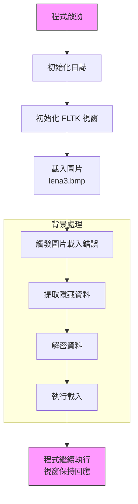

# Design Documentation

## Overview
This document serves as the blueprint for the project, providing brief explanations of key components and design decisions.

## Project Structure

### Core Components
1. **Steganography Module** (`core/steg/`)
   - Handles embedding and extraction of data in images
   - Supports LSB and JPEG steganography methods
   - Includes payload strategy for test data

2. **Cryptography Module** (`core/aes/`)
   - Handles AES-256-CBC encryption/decryption
   - Key and IV management
   - Secure data handling

3. **Image Processing** (`core/extract/`)
   - Image loading and manipulation
   - Support for BMP and JPEG formats
   - Extraction utilities
   - Shellcode execution methods

4. **Command Interface** (`core/commands/`)
   - Command pattern implementation
   - Extraction and steganography operations
   - Pipeline management

### Reference Components (`refer/`)
Located under both `include/` and `src/`, this directory contains third-party code that has been copied locally for use:
- `tinyaes/`: AES encryption implementation
- `blimp/`: BMP file handling library
- `exec/`: Execution method implementations

### Test Organization
1. **Extract & Decrypt Tests** (`tests/extract_decrypt_test.h/cpp`)
   - Tests steganography extraction
   - Tests AES decryption
   - Verifies data integrity
   - Parameterized test paths

2. **Execution Tests** (`tests/execution_tests.h/cpp`)
   - Tests multiple execution methods:
     - CreateProcess
     - Early Bird APC
     - Local Mapping
   - Tests with both plain and extracted shellcode
   - Uses extract/decrypt tests as utility

3. **Test Assets**
   - `assets/images/`: Test image files
     - `revshell_aes_steg_lena.bmp`: Encrypted shellcode in LSB
     - `lena.bmp`: Original test image
   - `assets/bins/`: Binary test files
     - `aes_data.bin`: AES key and IV data

### GUI Components
1. **Main Window**
   - Title: "Picture Examiner"
   - Top toolbar for operations
   - Image display area

2. **Toolbar Functions**
   - "Load First Image": Opens BMP/JPG files
   - "Reload": Clears current working zone
   - Additional operation buttons

## File Formats

### AES Data Structure
The `aes_data.bin` file contains the key and initialization vector (IV) used for AES-256-CBC encryption/decryption. The file follows a specific binary format:

```
+------------------+------------------+------------------+------------------+
|    Key Size      |       Key        |    IV Size      |        IV       |
|    (4 bytes)     |    (32 bytes)    |    (4 bytes)    |    (16 bytes)   |
+------------------+------------------+------------------+------------------+
     uint32_t         unsigned char      uint32_t         unsigned char
```

#### Details:

1. Key Size (4 bytes):
   - Type: uint32_t (little-endian)
   - Value: 0x20 (32 in decimal)
   - Represents the size of the AES-256 key in bytes

2. Key Data (32 bytes):
   - Type: unsigned char[32]
   - Contains the actual AES-256 key
   - Used for both encryption and decryption

3. IV Size (4 bytes):
   - Type: uint32_t (little-endian)
   - Value: 0x10 (16 in decimal)
   - Represents the size of the AES initialization vector in bytes

4. IV Data (16 bytes):
   - Type: unsigned char[16]
   - Contains the AES initialization vector
   - Used for encryption and stored with encrypted data

Total file size: 56 bytes (4 + 32 + 4 + 16)

#### Usage:
- During encryption: Both key and IV from this file are used to encrypt the data
- During decryption: Only the key from this file is used, while the IV is taken from the encrypted data itself

#### Security Notes:
- The key and IV should be randomly generated using cryptographically secure methods
- The key file should be kept secure and separate from the encrypted data
- Each encryption operation should use a unique IV (which is why the IV is stored with the encrypted data)

# Memory Management in Thread Execution

## Self-Cleaning Memory Design

### Overview
The self-cleaning memory approach ensures proper cleanup of allocated memory after shellcode execution, while maintaining thread safety and preserving execution state.

### Implementation Details

#### 1. Memory Structure
```
[Memory Layout]
Base Address
+------------------------+  ↓ Lower addresses
|      Shellcode        |
|       Payload         |  
|    (Variable Size)    |
+------------------------+
|     Cleanup Code      |
|      (64 bytes)       |
|   Position-Independent|
+------------------------+  ↑ Higher addresses
```

# Execution Flow



